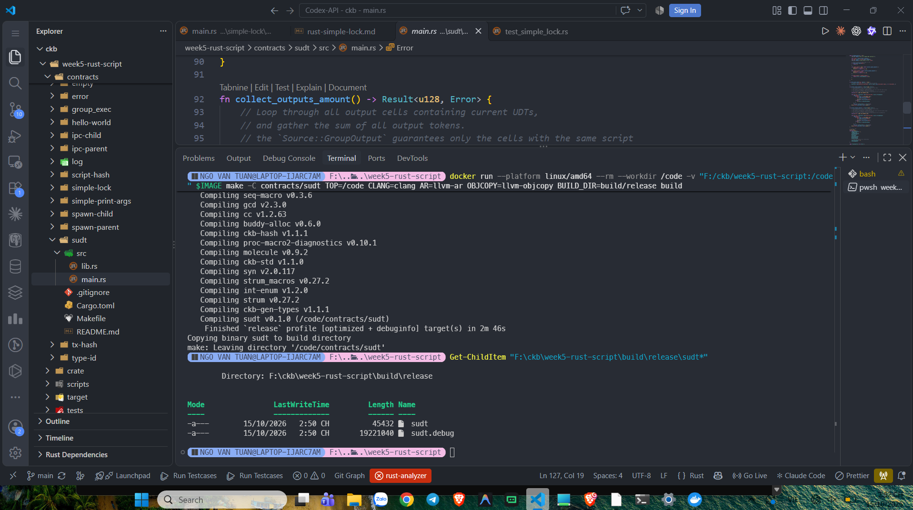
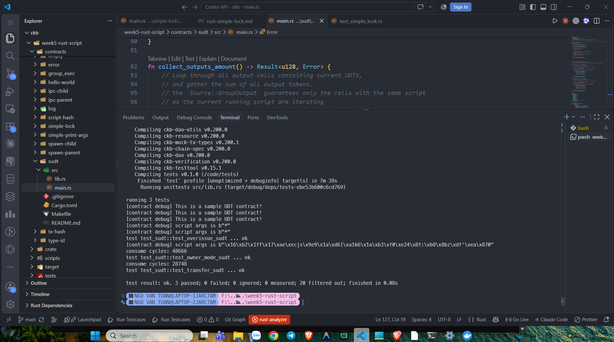

# CKBuilder Weekly Report — Week 5

**Author:** Tuan Ngo<br>
**Reporting date:** 15 October 2026<br>
**Status:** Completed<br>
**Scope:** Rust SUDT Type Script, token conservation, owner mode,
`GroupInput`, `GroupOutput`, CellDeps, and targeted CKB-VM tests

## Overview

This week I studied the Rust SUDT example from the handbook. Unlike a Lock
Script, which authorizes spending, a Type Script validates the state transition
of an asset carried by Cells. In this example, the asset amount is stored in
each Cell's data field as a 16-byte little-endian `u128`.

The contract verifies the SUDT conservation rule:

```text
total input amount >= total output amount
```

The owner mode is an exception for the owner identified by the Type Script
arguments. It allows the owner to mint or burn tokens without applying the
normal conservation comparison.

This work was performed locally with the handbook's Docker toolchain and
`ckb-testtool`. No Devnet deployment was required.

## Contract concepts

The contract uses `Source::GroupInput` and `Source::GroupOutput` to sum only
the input and output Cells belonging to the current SUDT Type Script group.
This prevents amounts belonging to another Type Script from being mixed into
the calculation.

The contract also checks owner mode by comparing the Type Script arguments
with the lock hash of an input Cell. If they match, the contract returns
success before applying the normal amount comparison.

The custom error codes are:

```text
12 - token amount data is shorter than the required 16 bytes
13 - output token amount is greater than input token amount
```

The SUDT bytecode is supplied to the transaction through a `CellDep`. The
dependency provides executable code to CKB-VM without being consumed as a
transaction input.

## Build

The SUDT contract was built separately with the pinned Docker LLVM/Rust image.
The build completed successfully and copied both the stripped and debug
artifacts:

```text
build/release/sudt
build/release/sudt.debug
```



*Figure 1. The handbook Docker toolchain builds the SUDT contract and produces
the release and debug binaries.*

## Targeted tests

The focused SUDT test module ran three cases:

| Test | Scenario | Expected result |
| --- | --- | --- |
| `test_transfer_sudt` | `400 -> 300 + 100` | Pass |
| `test_owner_mode_sudt` | owner creates `300 + 500` from `400` | Pass |
| `test_overissue_sudt` | non-owner creates `300 + 500` from `400` | Reject with error `13` |

The targeted command completed with:

```text
test result: ok. 3 passed; 0 failed
```

The `test_overissue_sudt` test is considered successful because it asserts that
the transaction is rejected with error code `13`; an `ok` result does not mean
that the over-issued transaction was accepted.



*Figure 2. The transfer, owner-mode, and over-issue rejection tests all pass
under `ckb-testtool` and CKB-VM.*

## What I learned

- Lock Scripts authorize spending, while Type Scripts validate asset/state
  transitions.
- SUDT amounts are stored in Cell data, separate from CKB capacity.
- `u128` amounts are encoded as 16-byte little-endian values.
- `GroupInput` and `GroupOutput` scope aggregation to the current Type Script.
- Owner mode provides a controlled mint/burn path.
- CellDeps provide Script bytecode without consuming the dependency Cell.
- A passing negative test means the expected rejection was observed.

## Scope note

The acceptance scope was the handbook SUDT contract and its three focused
tests. I did not run the complete workspace test suite because it includes
unrelated examples and requires their separate binaries. I also did not deploy
the SUDT contract to Devnet.

## Evidence

See the [Week 5 evidence index](../evidence/week-05/README.md).
