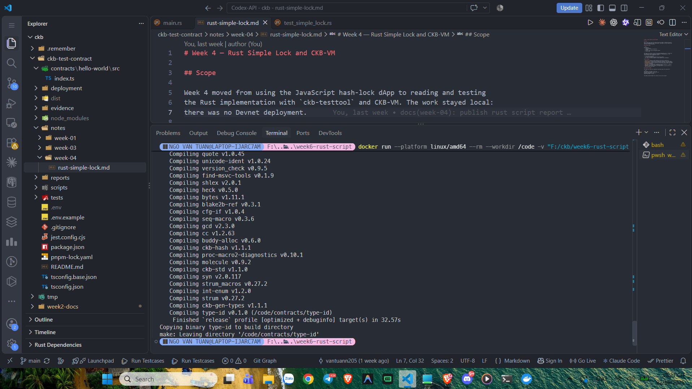
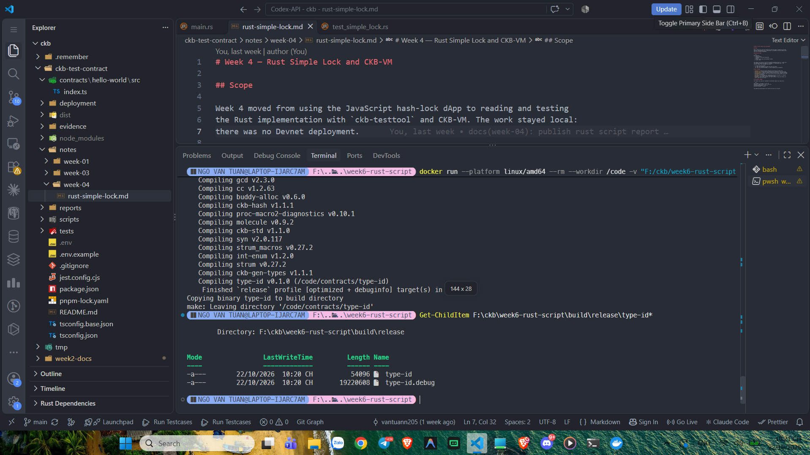
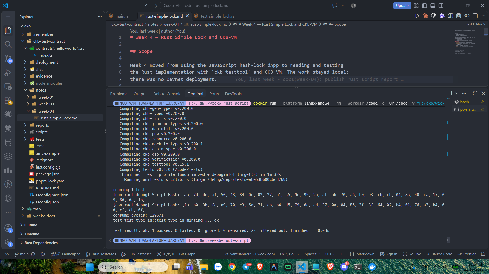

# CKBuilder Weekly Report — Week 6

**Author:** Tuan Ngo<br>
**Reporting date:** 22 October 2026<br>
**Status:** Completed<br>
**Scope:** Rust Type ID Script, Type ID derivation, output indexes,
unique Cell identity, and targeted CKB-VM testing

## Overview

This week I studied the Rust Type ID example from the handbook. Type ID is a
special CKB system Script pattern used to give a Cell type a deterministic
identity. The identity is derived from the input outpoint used to create the
Cell and the output index at which the Cell is created.

The Type ID check can be represented as:

```text
type_id = blake2b(input_outpoint || output_index_as_little_endian_u64)
```

The resulting 32-byte value is placed in the Type Script arguments. The
contract calls `ckb_std::type_id::check_type_id(32, 32)`, which checks the
32-byte Type ID located at offset 32 in the script arguments.

This work was performed locally with the handbook's Docker toolchain and
`ckb-testtool`. No Devnet deployment was required.

## Type ID test scenario

The targeted test creates one input Cell and two output Cells. Both output
Type IDs use the same input outpoint but different output indexes:

```text
output index 0 -> blake2b(input_outpoint || 0u64.to_le_bytes())
output index 1 -> blake2b(input_outpoint || 1u64.to_le_bytes())
```

Because the indexes differ, the two outputs receive different Type IDs. The
transaction is accepted only when the Type Script arguments contain the
corresponding derived values.

This demonstrates why Type ID prevents competing Cells from pretending to
share the same unique identity. It is also useful when a stable type reference
is needed for an upgradeable Script deployment.

## Build

The Type ID contract was built separately with the pinned Docker LLVM/Rust
toolchain. The compiler completed successfully:

```text
Finished `release` profile
Compiling type-id v0.1.0
```



*Figure 1. The Docker toolchain compiles the Rust Type ID contract for the
RISC-V target.*

The build copied the release and debug artifacts:

```text
build/release/type-id
build/release/type-id.debug
```



*Figure 2. The release and debug Type ID binaries are present in the build
directory.*

## Targeted test

The focused test command ran `test_type_id_minting` under `ckb-testtool` and
CKB-VM. The test passed:

```text
test test_type_id::test_type_id_minting ... ok
test result: ok. 1 passed; 0 failed
```

The debug output also printed the Script Hash values and consumed cycles,
confirming that both Type ID Script instances executed during verification.



*Figure 3. The Type ID minting test passes with one input and two uniquely
derived output Type IDs.*

## What I learned

- Type ID is a protocol-level identity mechanism for CKB Cells.
- The Type ID is derived from an input outpoint and a zero-based output index.
- Changing the output index changes the resulting 32-byte Type ID.
- The sample stores the Type ID at offset 32 in the Script arguments.
- Type ID is different from a normal token-conservation Type Script.
- A targeted test can verify Type ID derivation without deploying to Devnet.

## Scope note

The acceptance scope was the handbook Type ID contract and
`test_type_id_minting`. I did not run the complete workspace test suite,
deploy the contract to Devnet, or add custom negative tests for malformed or
duplicate Type IDs.

## Evidence

See the [Week 6 evidence index](../evidence/week-06/README.md).
