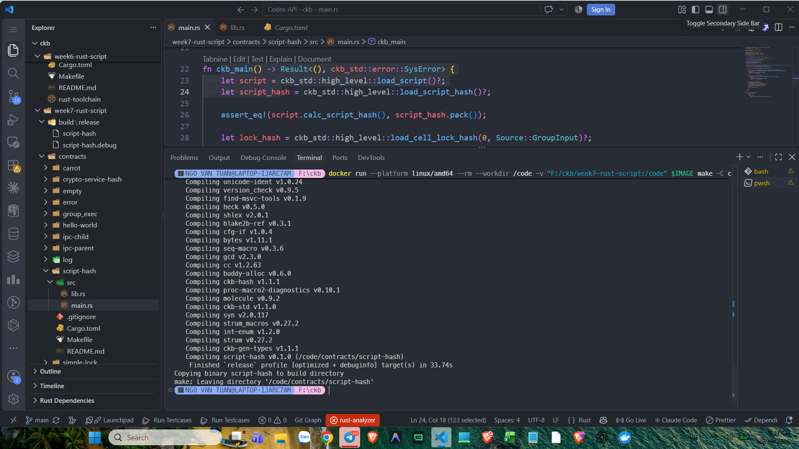
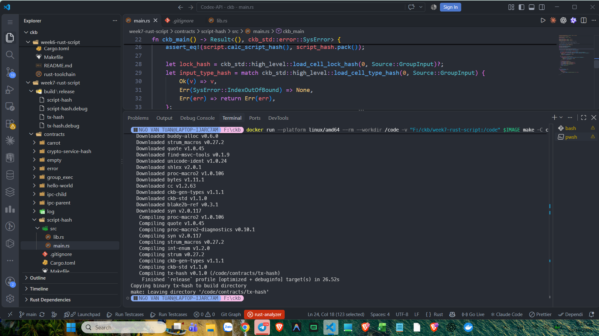
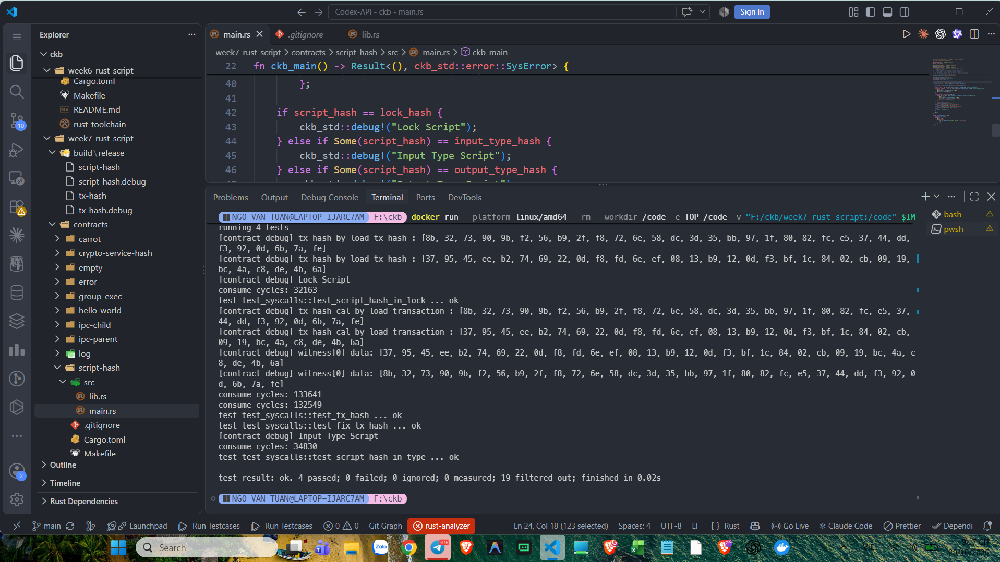
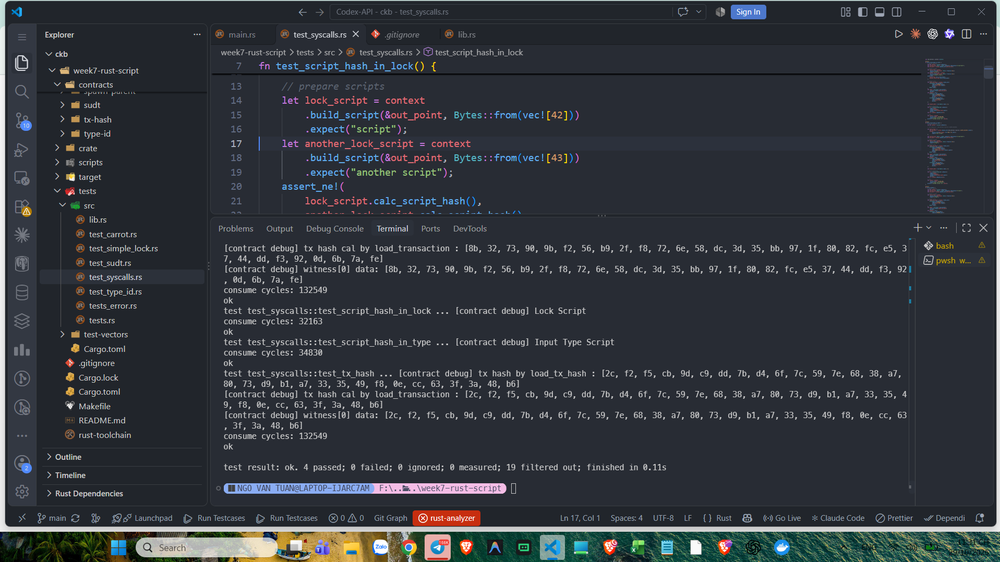

# CKBuilder Weekly Report — Week 7

**Author:** Tuan Ngo<br>
**Reporting date:** 29 October 2026<br>
**Status:** Completed<br>
**Scope:** Rust Script Hash and Transaction Hash syscalls, script identity,
raw transaction hashing, witnesses, and focused CKB-VM tests

## Overview

This week I worked through the handbook Rust examples for Script hashes and
transaction hashes. The exercise distinguishes the identity of the currently
executing Script from hashes stored on Cells, and distinguishes a transaction's
raw hash from its witness data.

The work was performed locally with the handbook Docker toolchain and
`ckb-testtool`. No Devnet deployment was required.

## Script hash checks

The `script-hash` contract loads the currently executing Script and its hash:

```rust
let script = ckb_std::high_level::load_script()?;
let script_hash = ckb_std::high_level::load_script_hash()?;

assert_eq!(script.calc_script_hash(), script_hash.pack());
```

This confirms that the hash returned by `load_script_hash` matches the
serialized Script calculated in the contract. The contract then compares the
current Script hash with:

- the lock hash of the first `GroupInput` Cell;
- the type hash of the first `GroupInput` Cell, when one exists;
- the type hash of the first `GroupOutput` Cell, when one exists.

The contract reports which role matched. The focused tests exercise the Lock
Script and Input Type Script paths.



*Figure 1. The contract loads the current Script and compares its calculated
hash with `load_script_hash`.*

## Build

The `script-hash` contract was built separately with the pinned Docker
LLVM/Rust toolchain. The release build completed successfully and copied the
binary into the build directory:

```text
Compiling script-hash v0.1.0
Finished `release` profile
Copying binary script-hash to build directory
```



*Figure 2. The Docker toolchain builds the RISC-V `script-hash` contract.*

## Transaction hash checks

The companion `tx-hash` contract reads the transaction hash with
`load_tx_hash`, loads the transaction, and hashes its raw form with the CKB
Blake2b personalization:

```text
ckb-default-hash
```

The contract verifies that the syscall hash equals the calculated raw
transaction hash. It also reads witness `0` and checks that the test supplied
the expected transaction hash there.

The test suite verifies an important property: changing witness data does not
change the raw transaction hash. Witnesses are not part of the raw transaction
hash, even though they are available to the executing Script.

## Targeted tests

The focused `test_syscalls` module completed four tests:

| Test | Scenario | Result |
| --- | --- | --- |
| `test_script_hash_in_lock` | Current Script is the input Cell's Lock Script | Pass |
| `test_script_hash_in_type` | Current Script is the input Cell's Type Script | Pass |
| `test_tx_hash` | Transaction hash is unchanged when witness data changes | Pass |
| `test_fix_tx_hash` | Deterministic transaction hash is passed through witness `0` | Pass |

```text
test result: ok. 4 passed; 0 failed; 0 ignored
```



*Figure 3. The focused test run logs the Lock Script, Input Type Script, and
transaction hash checks, then completes successfully.*



*Figure 4. The test source and final result confirm the four targeted syscall
tests pass.*

## What I learned

- A Script hash identifies the full Script definition: code hash, hash type,
  and arguments.
- `load_script_hash` returns the hash of the currently executing Script.
- A Cell's lock hash and type hash can be loaded independently through
  high-level syscalls.
- Type Scripts are optional, so the contract handles `IndexOutOfBound` by
  treating a missing type hash as `None`.
- `load_tx_hash` hashes the raw transaction, not witness data.
- Witnesses can carry runtime verification data without changing the raw
  transaction hash.
- Targeted CKB-VM tests can validate syscall behavior without a Devnet
  deployment.

## Scope note

The acceptance scope was the handbook `script-hash` and `tx-hash` examples and
the four tests in `test_syscalls`. I did not run the complete workspace suite
because it includes unrelated handbook contracts that require separately built
binaries. The output Type Script debug branch exists in the contract but was
not covered by this focused run.

## Evidence

See the [Week 7 evidence index](../evidence/week-07/README.md).
