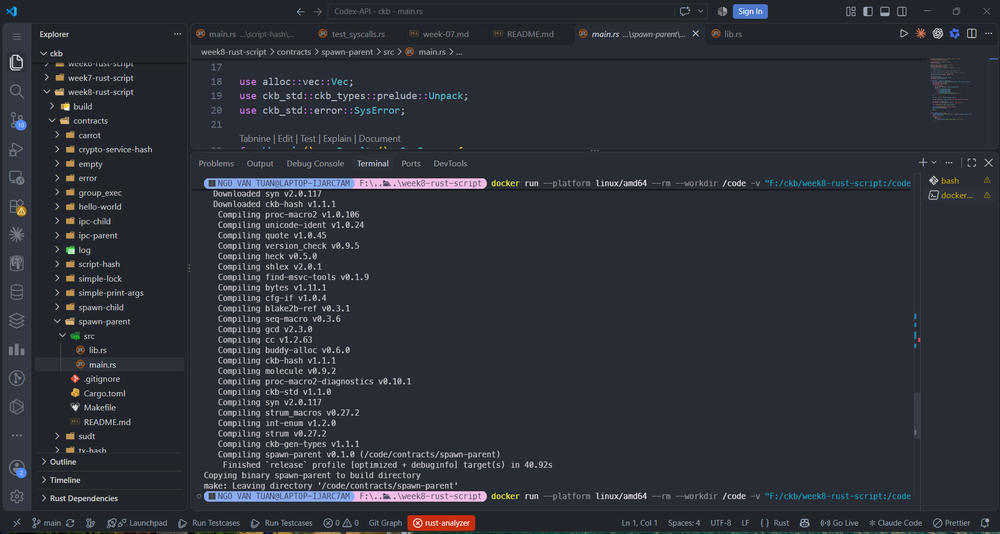
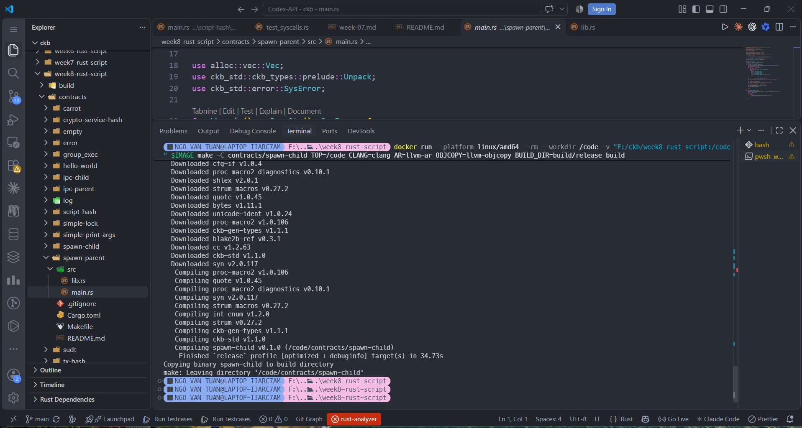
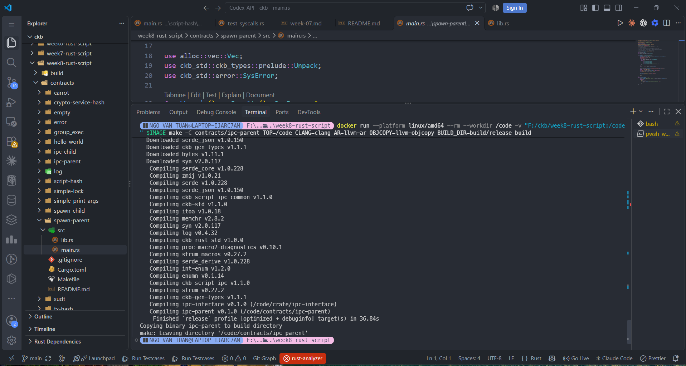
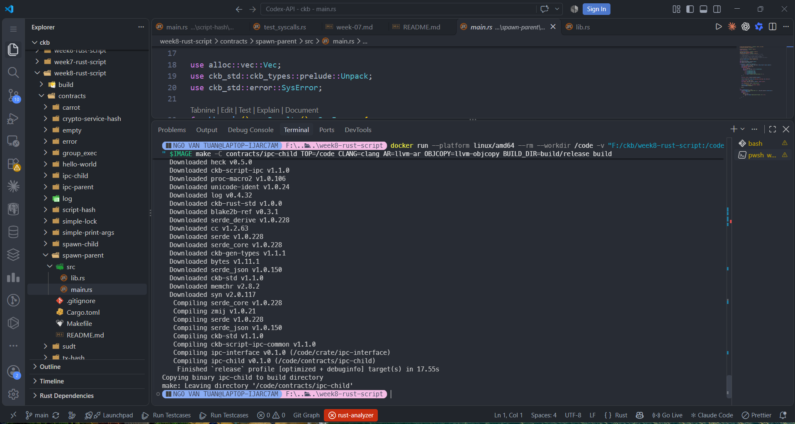
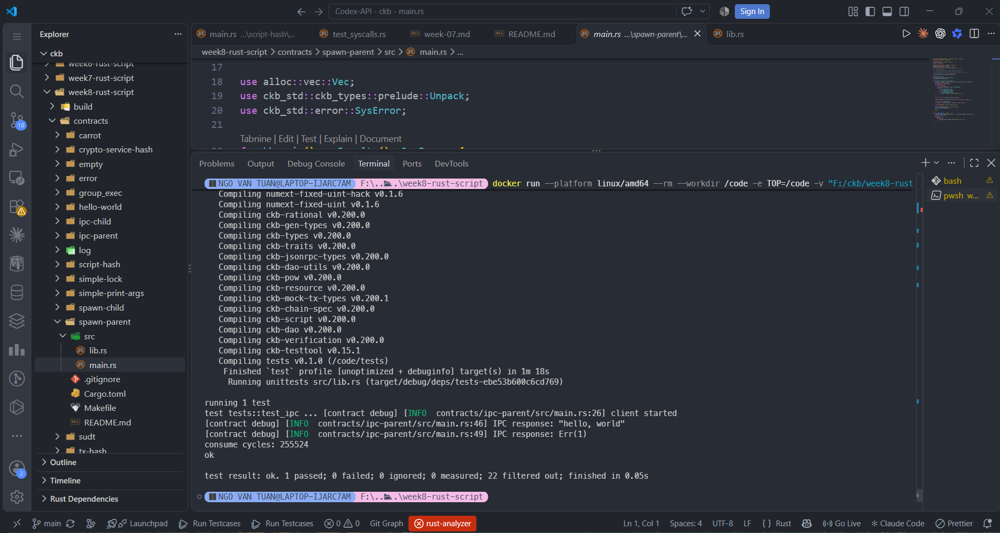

# CKBuilder Weekly Report — Week 8

**Author:** Tuan Ngo<br>
**Reporting date:** 5 November 2026<br>
**Status:** Completed<br>
**Scope:** CKB-VM process spawning and inter-process communication (IPC),
including four contract builds and two focused `ckb-testtool` tests

## Overview

This week I studied how one CKB Script can start another Script as a child
process, and how parent and child processes communicate through pipes. I also
worked through the higher-level IPC example, where a client invokes a server
through a shared interface.

All work was local and used the handbook Docker toolchain with
`ckb-testtool`. No Devnet deployment was required.

## Build

I built the parent and child contracts for both examples:

| Contract | Role | Result |
| --- | --- | --- |
| `spawn-parent` | Starts the child Script and reads its pipe output | Build passed |
| `spawn-child` | Writes a message for its parent | Build passed |
| `ipc-parent` | Starts the IPC server and calls its interface | Build passed |
| `ipc-child` | Serves the IPC request | Build passed |









## Spawn: Parent and Child Scripts

The parent reads the child Script's code hash and hash type from its arguments,
creates a pipe, and calls `spawn_cell` with the pipe's write descriptor. The
child writes `Hello World`; the parent reads the pipe and checks the message.
The child code Cell is also included as a code dependency in the test
transaction, making its bytecode available to the VM.

The focused `test_spawn` run passed. Its output reported parent PID `0`, child
PID `1`, the successful `Checked` assertion, and 141,830 consumed cycles.
The supplied Spawn result was terminal text rather than a distinct screenshot,
so it is preserved as a transcript in the evidence folder.

```text
running 1 test
test tests::test_spawn ... [contract debug] Spawn Parent PID: 0 !
[contract debug] Spawn Child PID: 1 !
[contract debug] Checked
consume cycles: 141830
ok

test result: ok. 1 passed; 0 failed; 0 ignored; 0 measured; 22 filtered out
```

## IPC: Client and Server

The IPC parent starts a child server with `spawn_cell_server`, then uses the
generated `WorldClient` interface to call `hello("world")`. The test log shows
the response `"hello, world"`. A second call using `"error"` returns `Err(1)`,
demonstrating the example's error response path while the transaction test
itself still passes.

The focused `test_ipc` test completed with `1 passed; 0 failed` and reported
255,524 consumed cycles.



The second supplied test screenshot shows the same IPC output and is retained
in the evidence index as a duplicate capture, not as a separate test run.

## What I Learned

- `spawn_cell` lets a running Script launch another on-chain program in a new
  CKB-VM process.
- File descriptors passed to the child allow the parent and child to exchange
  bytes through a pipe.
- The child program must be available to the transaction through a code
  dependency.
- The IPC helper and shared interface provide a request/response abstraction
  over the lower-level process and pipe operations.
- The IPC example demonstrates both a normal response and a returned error.

## Scope Note

Acceptance was limited to the four individual contract builds and the focused
`test_spawn` and `test_ipc` tests. I did not run the full workspace suite or
deploy these examples to Devnet.

## Evidence

See the [Week 8 evidence index](../evidence/week-08/README.md).
