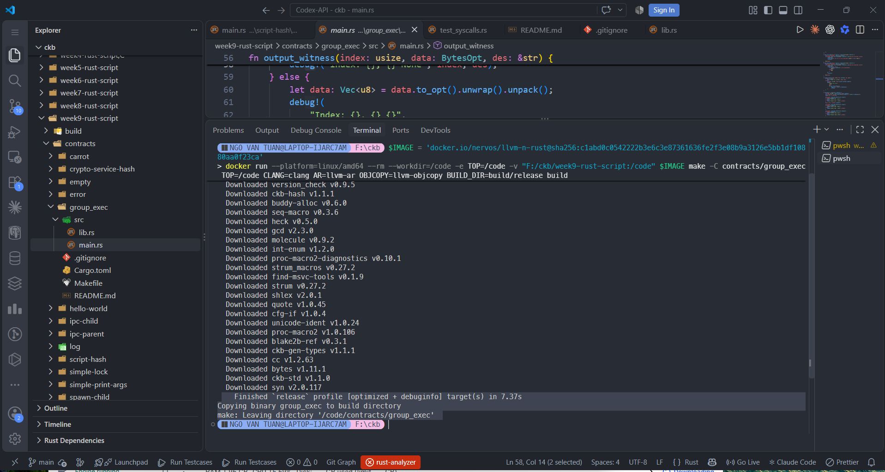
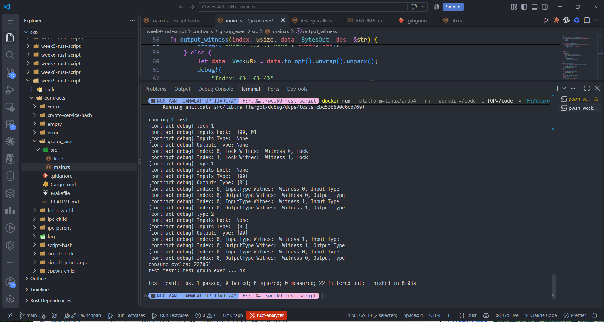
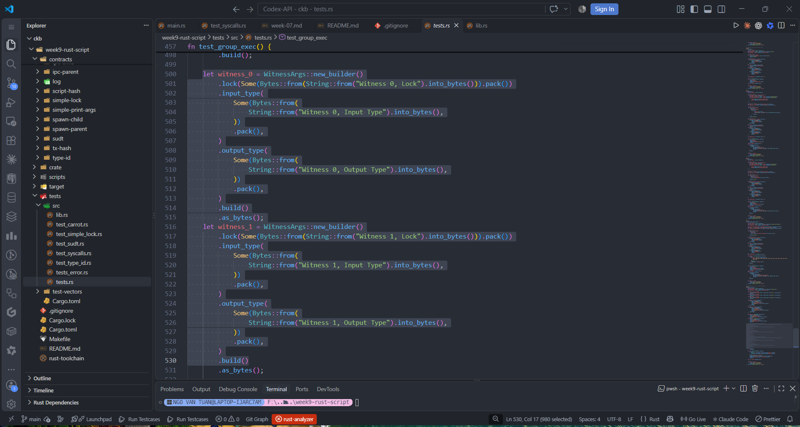

# CKBuilder Weekly Report — Week 9

**Author:** Tuan Ngo<br>
**Reporting date:** 12 November 2026<br>
**Status:** Completed<br>
**Scope:** CKB Script Group execution and `WitnessArgs`, using the handbook
`group_exec` contract and focused `test_group_exec`

## Overview

This week I studied how CKB groups Cells that use the same Lock or Type Script,
and how each Script group reads the corresponding witnesses. The exercise uses
the handbook's `group_exec` example and a local `ckb-testtool` transaction.
No Devnet deployment was needed.

## Build and Test

The `group_exec` contract compiled for the RISC-V target and was copied to
`build/release/group_exec`. The first attempt compiled the contract but could
not copy it because `build/release` did not exist; creating that directory and
rerunning the build completed successfully.

The focused `test_group_exec` test passed with 227,051 cycles:

```text
test tests::test_group_exec ... ok
test result: ok. 1 passed; 0 failed; 0 ignored; 0 measured; 22 filtered out
```





## Script Groups and Witnesses

The test creates two inputs and two outputs. Both inputs share `lock 1`, so
that Lock Script runs for the input group containing indices 0 and 1. The Type
Scripts form separate groups:

| Script group | Input Cells | Output Cells |
| --- | --- | --- |
| `lock 1` | Input 0, Input 1 | Output 0, Output 1 |
| `type 1` | Input 0 | Output 1 |
| `type 2` | Input 1 | Output 0 |

The test fills each `WitnessArgs` with `lock`, `input_type`, and `output_type`
data. The contract logs show the Lock group reading the two lock witnesses,
while the Type Script groups read the type fields associated with their input
and output Cells. The index printed inside a group is its position in that
group's virtual input/output sequence; the witness content identifies which
transaction witness supplied the data.



## What I Learned

- CKB runs each distinct Script group against the Cells that use that Script.
- Lock Script groups are formed from input Cells; Type Script groups can include
  both input and output Cells.
- `GroupInput` and `GroupOutput` expose the Cells belonging to the current
  Script group.
- `WitnessArgs` separates lock data from Type Script input and output data so
  multiple Script groups can use witness data without colliding.
- A focused `ckb-testtool` test can show group membership and witness access
  without deploying to Devnet.

## Scope Note

Acceptance was limited to building `group_exec` and running
`test_group_exec`. I did not run the full workspace suite or deploy to Devnet.

## Evidence

See the [Week 9 evidence index](../evidence/week-09/README.md).
