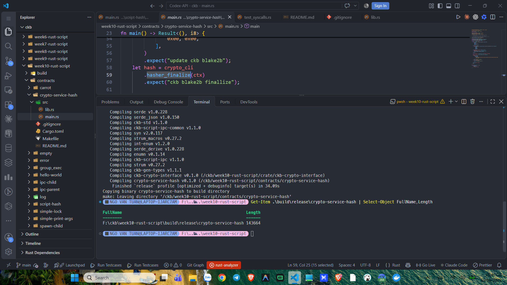
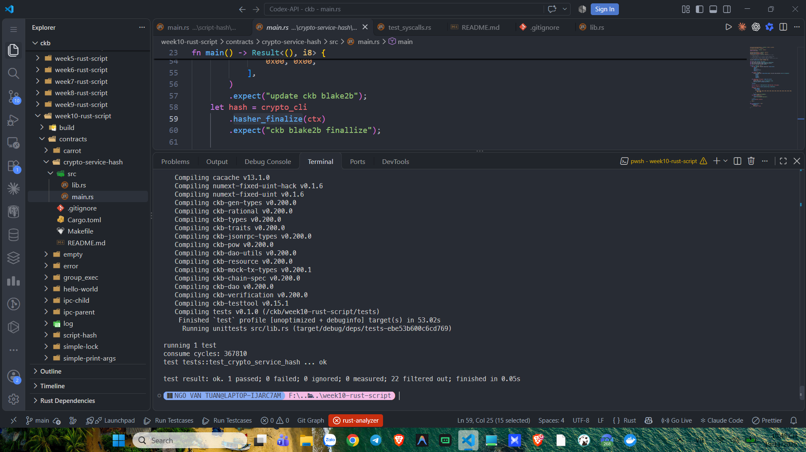
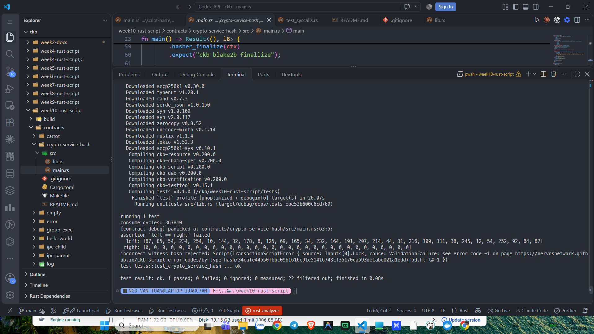

# CKBuilder Weekly Report — Week 10

**Author:** Tuan Ngo 
**Reporting date:** 19 November 2026 
**Status:** Completed 
**Scope:** `crypto-service-hash`, CKB crypto service IPC, `CellDep`, and valid/invalid witness verification with `ckb-testtool`

## Overview

This week I studied the handbook `crypto-service-hash` example. The Lock Script
starts the crypto service through CKB-VM process spawning, sends a CKB Blake2b
request over IPC, and compares the result with the expected hash carried in
`WitnessArgs.lock`.

## Build and Verification

The `crypto-service-hash` contract compiled for the RISC-V target and was copied
to `build/release/crypto-service-hash` using the pinned handbook Docker image.

The focused `test_crypto_service_hash` test covered two transactions:

- The expected hash in the witness matched the crypto service result, so
  verification passed and consumed 367,810 cycles.
- The test replaced the witness with 32 zero bytes. The Script assertion failed
  as expected, CKB rejected that transaction, and the test confirmed the
  rejection. The test itself finished successfully: 1 passed, 0 failed.

## What I Learned

- `CellDep` makes the crypto service code Cell available to the transaction.
- The Lock Script receives the crypto service Type Script hash through its
  `args`, starts the service, and communicates with it through IPC pipes.
- The witness carries the expected result; a matching hash passes, while a
  mismatched hash causes the Script to fail and the transaction to be rejected.
- Replacing a transaction's witness vector requires `set_witnesses`; the
  `witnesses` builder method extends the existing vector and can leave the old
  witness at index 0.

## Scope Note

Acceptance covered the contract build and the focused `test_crypto_service_hash`
test only. The full workspace suite and Devnet deployment were not performed.

See the [Week 10 evidence index](../evidence/week-10/README.md).
